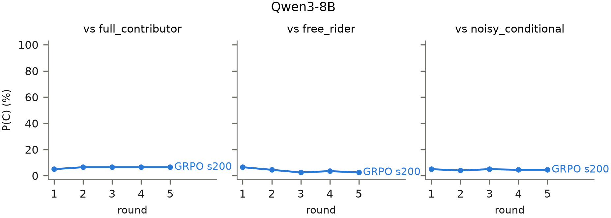
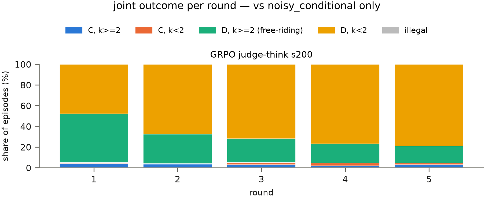

# Multi-round eval: qwen3_8b / pgg / multi_round_fabopen_grpo_judge-think_seed1_n200

Qwen3-8B, game `public_goods`, representation `decision_full`, 5 live rounds per episode, cold open (no fabricated history; rules in round 1 only, one outcome message per later round, conversation accumulates), opponents `full_contributor`, `free_rider`, `noisy_conditional`, 20 episodes per opponent per policy, T = 0.7, no moral text in any prompt. Jobs 27317336; parse-failure at worst 0.0%.

Policies are the single-step-trained checkpoints; this document measures them IN PLAY. The single-round tables are the same policies' fabricated-history rows (Table M2 pairs them).

### Table M1 — cooperation per round, in play

*Live episodes: cold open (round 1 has no history), one conversation per episode, moves simultaneous.*

P(C) per round over that opponent's episodes (20 per cell, binomial s.e. ≤11 points/round). pooled = all decisions. Round 1 is the untrained opening state; later rounds condition on the episode's own history.

**vs 'full_contributor'**

| Policy | r1 | r2 | r3 | r4 | r5 | pooled |
|---|---|---|---|---|---|---|
| GRPO judge-think s200 | 5 | 6 | 6 | 6 | 6 | **6** |

**vs 'free_rider'**

| Policy | r1 | r2 | r3 | r4 | r5 | pooled |
|---|---|---|---|---|---|---|
| GRPO judge-think s200 | 6 | 4 | 2 | 4 | 2 | **4** |

**vs 'noisy_conditional'**

| Policy | r1 | r2 | r3 | r4 | r5 | pooled |
|---|---|---|---|---|---|---|
| GRPO judge-think s200 | 5 | 4 | 5 | 4 | 4 | **5** |

### Figure 1 — cooperation per round

One panel per opponent, one line per policy (base dashed grey). An alternating line is the repair-retaliate 2-cycle; a rising flat-topped line is absorption into cooperation.

### Figure 2 — joint-outcome composition per round

Vs `noisy_conditional` (the reactive opponent), each bar splits that round's episodes by joint outcome. Absorption = one band taking over; the repair-retaliate cycle = the exploiting and suckered bands swapping between rounds.

### Table M2 — the state table measured in play

*Rounds \geq2 pooled over opponents and rounds; states are the episode's own realized (last move, observation) pairs, so their frequencies are policy-dependent and UNBALANCED.*

P(C | state) in live play, under each policy its single-round fabricated-history row where evaluated (--reference): matching numbers mean the installed table survives the conversation surface. * marks live cells with n < 10 — read those as anecdotes.

| Policy | C<small>A</small>,k=0 | C<small>A</small>,k=1 | C<small>A</small>,k=2 | C<small>A</small>,k=3 | D<small>A</small>,k=0 | D<small>A</small>,k=1 | D<small>A</small>,k=2 | D<small>A</small>,k=3 |
|---|---|---|---|---|---|---|---|---|
| GRPO judge-think s200 | 13 | 4 | 8 | 60 | 2 | 0 | 1 | 1 |
|   · single-round (fabricated) | 0 | 0 | 6 | 26 | 0 | 2 | 2 | 2 |

*Live n per cell varies by policy (a policy that never reaches a state contributes no estimate there).*

### Table M3 — episode outcomes

*Per policy and opponent, over that cell's episodes.*

open = P(C) in round 1, the state training never showed. final = P(C) in round 5. mutual coop = share of episodes whose LAST round is jointly cooperative (agent C and the opponent/majority of co-players C) — the absorption readout.

| Policy | opponent | open | final | mutual coop | episodes |
|---|---|---|---|---|---|
| GRPO judge-think s200 | 'full_contributor' | 5 | 6 | 6 | 200 |
|  | 'free_rider' | 6 | 2 | 0 | 200 |
|  | 'noisy_conditional' | 5 | 4 | 3 | 200 |

### Table M4 — reasoning traces in play

*All rounds and opponents pooled.*

normative % = trace contains a reviewed moral word stem; recites % = reproduces \geq6 consecutive words of the 'deontological' wording (verbatim only). The principle text is in none of these prompts.

| Policy | n | normative % | recites % |
|---|---|---|---|
| GRPO judge-think s200 | 3000 | 6 | 0 |

